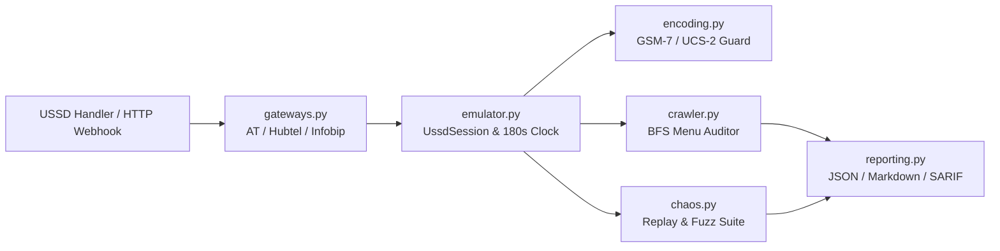

# ussdkit

[](https://github.com/codesphere-u/ussdkit/actions/workflows/ci.yml)
[](LICENSE)
[](pyproject.toml)
[](pyproject.toml)

**Stateful USSD & GSM session emulator, 3GPP TS 23.038 GSM-7/UCS-2 byte-budget guard, automated BFS menu-tree crawler, and telco chaos testing suite.**

- **Mission Domain:** Telecom & Mobile-Money Infrastructure
- **Stack:** Pure Python 3.11+ (zero runtime third-party dependencies, `mypy --strict`, `ruff`, `pytest`)
- **Maintainer:** Codesphere Innovations (U) Limited (`codesphere-u`)

---

## Problem Solved

Millions of subscribers rely on `*123#` USSD services across 2G/3G feature phones, yet engineering teams still test menus manually. A single curly apostrophe or emoji triggers the UCS-2 cliff (shrinking screen budgets from 182/160 septets to 80/70 UTF-16 units and silently truncating options), while 2G gateway retries trigger duplicate debits in non-idempotent handlers.

## Key Features

- Exact 3GPP TS 23.038 GSM-7 basic + 2-septet extension alphabet & UCS-2 surrogate-pair accounting with automated GSM-7 sanitization suggestions.
- Multi-gateway webhook codecs for Africa's Talking (`CON`/`END`), Hubtel JSON, Infobip JSON, and Generic JSON/text.
- Stateful `UssdSession` emulator supporting in-process Python callables and live HTTP/HTTPS webhooks, `*384*1*2#` fast-path dialing, and deterministic 180-second telco timeout enforcement.
- Automated BFS `UssdTreeCrawler` auditing all reachable menus across 7 rules (`USSD-001`..`USSD-007`).
- `UssdChaosRunner` verifying duplicate-callback idempotency (`CHAOS-001`), timeout enforcement (`CHAOS-002`), and 7 adversarial input classes.
- Markdown, JSON, and SARIF v2.1.0 outputs for GitHub Code Scanning CI gates.

## Architecture Overview



See [docs/architecture.md](docs/architecture.md) for module-level design details.

## Installation

```bash
git clone https://github.com/codesphere-u/ussdkit.git
cd ussdkit
uv sync --extra dev
```

Or install in editable mode with standard `pip`:

```bash
pip install -e ".[dev]"
```

## Quick Start (CLI)

```bash
ussdkit check-text "1. Balance\n2. Send Money" --strict-160
ussdkit dial demo --inputs "2,0772000111,5000,1"
ussdkit crawl demo --format markdown
ussdkit chaos demo --format json
```

## Quick Start (Python API)

```python
from ussdkit import CallableTransport, UssdChaosRunner, UssdTreeCrawler
from ussdkit.cli import demo_mobile_money_handler

transport = CallableTransport(demo_mobile_money_handler)
assert UssdTreeCrawler(transport).crawl().passed
assert UssdChaosRunner(transport).run_all(happy_path=("1",)).passed
```

## Testing & Quality Gates

```bash
uv run ruff check src tests
uv run mypy src
uv run pytest -v
```

## Security, Contributing & Roadmap

- **Security:** See [SECURITY.md](SECURITY.md) for responsible disclosure procedures.
- **Contributing:** See [CONTRIBUTING.md](CONTRIBUTING.md) and [CODE_OF_CONDUCT.md](CODE_OF_CONDUCT.md).
- **Changelog & Roadmap:** See [CHANGELOG.md](CHANGELOG.md) and [ROADMAP.md](ROADMAP.md).

## License

MIT License — see [LICENSE](LICENSE).

## Support & Contact

Open an issue on [GitHub Issues](https://github.com/codesphere-u/ussdkit/issues) or contact `codesphereinnovationz@gmail.com`.
